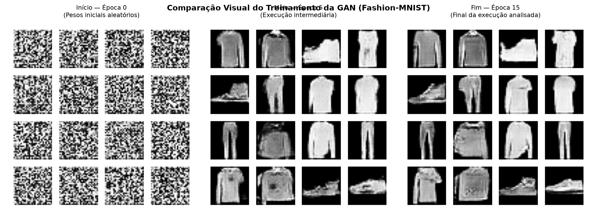

# Comparação Visual do Treinamento — Sprint 3

## 1. Momentos Selecionados

Foram reunidas três grades 4x4 (16 amostras cada) geradas a partir de um mesmo vetor de ruído fixo durante a execução de 15 épocas sobre a base Fashion-MNIST (28x28 pixels em tons de cinza):

- **Início (artefatos/sprint2_epoca_0.png — Época 0):** Saída do Gerador com pesos aleatórios, antes do ajuste adversarial.
- **Meio (artefatos/sprint2_epoca_5.png — Época 5):** Estágio intermediário correspondente a um terço da execução.
- **Fim (artefatos/sprint2_epoca_15.png — Época 15):** Estágio final da execução analisada.

---

## 2. Diferenças Observadas (Análise Descritiva sem Presumir Melhora)

1. **Época 0 (Início):**
   - Os 16 quadros apresentam pixels cinzas e brancos espalhados por toda a área 28x28, com aspecto de chuvisco estático.
   - Não há separação entre fundo e objeto central, nem contornos associados a peças de vestuário.

2. **Época 5 (Meio):**
   - Surge contraste entre as bordas dos quadros (que escurecem em direção ao preto) e a região central (que agrupa pixels claros).
   - Aparecem silhuetas verticais e horizontais básicas, mas com bordas borradas, manchas cinzas residuais ao redor das figuras e ausência de divisões internas claras.

3. **Época 15 (Fim da execução analisada):**
   - O contraste entre o fundo preto e as figuras centrais torna-se mais marcado. Algumas amostras exibem recortes específicos, como fendas verticais que lembram pernas de calças, formatos horizontais que lembram calçados e projeções laterais semelhantes a mangas.
   - **Limitações e artefatos mantidos:** O avanço das épocas não tornou todas as imagens nítidas ou reconhecíveis. Parte dos quadros permanece como blocos retangulares cinzas indefinidos; há mangas assimétricas ou interrompidas e áreas totalmente brancas sem variação interna de textura.
