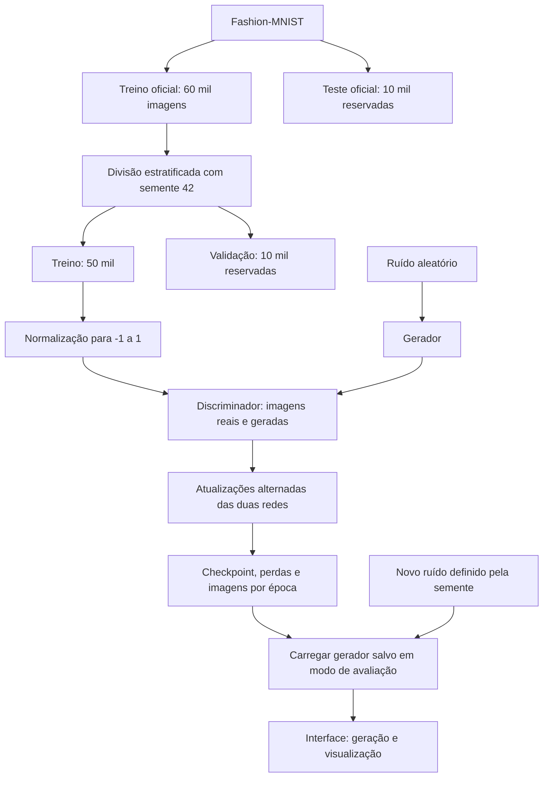

# Fluxograma do processo real

Validação e teste não atualizam as redes. A interface apenas carrega o modelo, sem treinar.
O painel histórico original é apresentado separadamente da execução local.
Este fluxograma complementa o diagrama simplificado exibido na interface.

## Entrega educativa

Os resultados técnicos alimentam a aplicação, a apostila introdutória e o relatório acadêmico. A conclusão inclui revisão dos exemplos, textos e comandos pelos próprios autores. O roteiro é de leitura e exploração autônoma.
